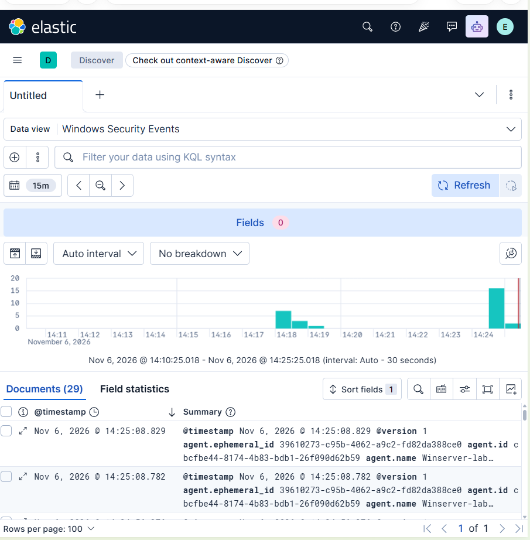

# Mốc 06 — Thu thập Windows Event Log bằng Winlogbeat

**Trạng thái:** Hoàn thành

**Ngày hoàn thành:** 06-11-2026

## 1. Mục tiêu đạt được

- Cài Winlogbeat `9.5.6` trên Windows Server 2022 (`winserver-lab`).
- Thu thập Windows Security, System và Application Event Log.
- Chuyển sự kiện qua kênh Beats TLS đến Logstash tại `192.168.109.10:5044`.
- Lập chỉ mục sự kiện Windows trong Elasticsearch và trực quan hóa bằng Kibana
  Discover.

## 2. Cấu hình đã áp dụng

| Thành phần | Cấu hình đã kiểm chứng |
| --- | --- |
| Windows collector | Windows Server 2022, hostname `winserver-lab`, VMnet1 `192.168.109.20/24` |
| SIEM collector endpoint | Logstash `192.168.109.10:5044/TCP` |
| Mã hóa đường truyền | TLS 1.3, CA nội bộ của Elastic Stack |
| Xác minh chứng chỉ | `verification_mode: full` với DNS name `logstash` |
| Index đích | `siem-windows-YYYY.MM.dd` |
| Data view Kibana | `Windows Security Events` với pattern `siem-windows-*` và time field `@timestamp` |

Windows hosts file ánh xạ `192.168.109.10 logstash`. Cách này giữ được hostname
verification đầy đủ vì certificate Logstash có DNS SAN `logstash`; không hạ mức
xác minh TLS.

## 3. Nguồn sự kiện được thu thập

- `Security`: 4624, 4625, 4634, 4648, 4672, 4720, 4728, 4732 và 4740.
- `System`.
- `Application`.

Sau khi cài dịch vụ Winlogbeat, kiểm tra cấu hình trả về `Config OK`; kiểm tra
output xác nhận phân giải `logstash` về `192.168.109.10`, TLS handshake thành
công và `talk to server... OK`.

## 4. Bằng chứng runtime

Logstash đã restart sau khi cập nhật pipeline và đạt health check `healthy`.
Logs xác nhận input Beats lắng nghe tại `0.0.0.0:5044`, kết nối Elasticsearch
thành công, pipeline `main` đang chạy.

Elasticsearch có index thực tế:

```text
yellow open siem-windows-2026.11.05 ... docs.count: 2
```

Sau khi restart dịch vụ Winlogbeat và refresh Discover, Kibana hiển thị 29
documents trong 15 phút, thuộc data view `Windows Security Events`.



`yellow` là trạng thái dự kiến của Elasticsearch một node: replica chưa thể
được phân bổ vì lab không có node thứ hai. Đây không phải lỗi thu thập log.

## 5. Hạn chế và bước tiếp theo

- Kibana hiện dùng HTTP trong VMnet1 Host-only; HTTPS browser-to-Kibana là một
  hạng mục hardening tách riêng trước khi dùng ngoài lab.
- Chưa có pfSense collector; bước tiếp theo là dựng pfSense và gửi Syslog đến
  `192.168.109.10:5514/UDP`.
- Cần xây dashboard và detection rule sau khi có đủ Windows và firewall logs.
