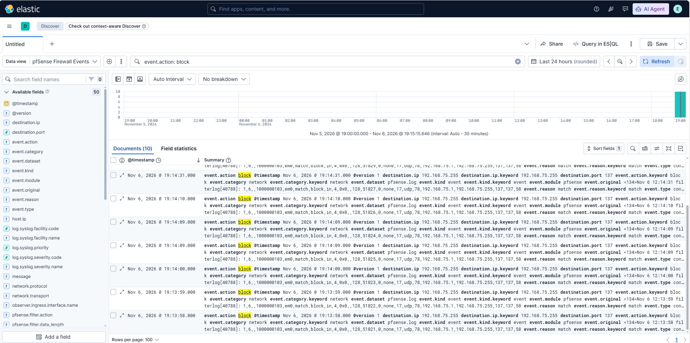

# Mốc 07 — Thu thập pfSense Syslog

**Trạng thái:** Hoàn thành

**Ngày hoàn thành:** 06-11-2026

## 1. Mục tiêu đạt được

- Cài pfSense CE `2.9.0-RELEASE` trên VMware.
- Gửi Syslog từ pfSense đến Logstash trên Ubuntu SIEM qua mạng Host-only.
- Lập chỉ mục dữ liệu firewall và DHCP trong Elasticsearch.
- Tạo data view `pfSense Firewall Events` trong Kibana Discover.
- Tách các trường chính của pfSense `filterlog` để phục vụ tìm kiếm và cảnh báo.

## 2. Cấu hình đã kiểm chứng

| Thành phần | Cấu hình thực tế |
| --- | --- |
| pfSense WAN | `em0`, DHCP/NAT, `192.168.75.138/24` tại thời điểm kiểm tra |
| pfSense LAN | `em1`, tĩnh `192.168.109.254/24`, DHCP server tắt |
| Đích Syslog | `192.168.109.10:5514/UDP` |
| Nội dung gửi | System, Firewall, DNS, DHCP và General Authentication Events |
| Elasticsearch index | `siem-pfsense-YYYY.MM.dd` |
| Kibana data view | `pfSense Firewall Events`, pattern `siem-pfsense-*`, time field `@timestamp` |

Chỉ mạng Host-only `192.168.109.0/24` được dùng cho đường đi Syslog trong lab.
UDP Syslog không được dùng cho Internet hoặc môi trường production.

## 3. Bằng chứng runtime

Sau khi bật Remote Logging trên pfSense, kiểm tra trực tiếp trong container
Elasticsearch trả về index thực tế:

```text
yellow open siem-pfsense-2026.11.06 ... docs.count: 8
```

Kibana Discover hiển thị cả DHCP client (`dhcp6c`) và firewall (`filterlog`).
Sau khi reload Logstash với parser, truy vấn `event.action: block` trả về 10
firewall events mới. Mỗi event đã có `action=block`, giao thức UDP, IP
nguồn/đích, cổng nguồn/đích và interface. Pipeline Logstash dùng mẫu này để
tách các trường `event.action`, `network.transport`, `source.*`,
`destination.*` và `observer.ingress.interface.name`, đồng thời gắn tag
`pfsense_firewall_block` cho event bị chặn.



Trạng thái `yellow` là dự kiến với Elasticsearch một node vì replica chưa có
node thứ hai để phân bổ.

## 4. Hạn chế và bước tiếp theo

- Parser hiện tập trung vào IPv4 `filterlog`; các định dạng IPv6/TCP nâng cao
  cần được kiểm thử bằng dữ liệu lab thực tế trước khi mở rộng.
- Cần reload Logstash, tạo dữ liệu firewall mới và kiểm chứng các trường đã
  parse trong Kibana.
- Mốc tiếp theo là dashboard và rule phát hiện cho Windows failed logon và
  pfSense firewall block.
