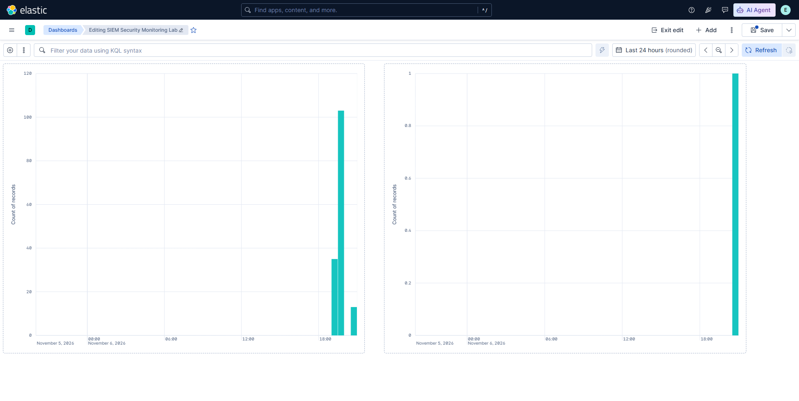

# Mốc 08 — Kibana Security Dashboard

**Trạng thái:** Hoàn thành

**Ngày hoàn thành:** 06-11-2026

## 1. Mục tiêu đạt được

- Tạo dashboard Kibana `SIEM Security Monitoring Lab`.
- Hiển thị số lượng pfSense firewall events bị chặn theo thời gian.
- Hiển thị số lượng Windows failed logon (Event ID `4625`) theo thời gian.
- Kiểm chứng cả hai panel bằng dữ liệu runtime trong cùng khoảng thời gian 24 giờ.

## 2. Thiết kế dashboard

| Panel | Data view | Lọc dữ liệu | Ý nghĩa |
| --- | --- | --- | --- |
| pfSense Firewall Blocks | `pfSense Firewall Events` | `event.action: block` | Theo dõi packet bị firewall chặn theo thời gian |
| Windows Failed Logons | `Windows Security Events` | `event.code: "4625"` | Theo dõi các lần xác thực thất bại trên Windows Server |

Cả hai biểu đồ dùng trục ngang `@timestamp` (date histogram) và trục dọc là
Count of records. Dashboard dùng time picker `Last 24 hours` để có cùng ngữ
cảnh thời gian giữa hai nguồn.

## 3. Kiểm thử runtime

Trước kiểm thử, panel Windows chưa có dữ liệu vì lab chưa phát sinh Event ID
`4625`. Audit failure cho subcategory `Logon` được bật trên Windows Server:

```powershell
auditpol /set /subcategory:"Logon" /failure:enable
```

Một lần xác thực sai bằng tài khoản lab không tồn tại được tạo có kiểm soát.
Panel Windows sau đó hiển thị một cột với Count of records bằng 1. Panel
pfSense đồng thời tiếp tục hiển thị firewall block events đã parse.



## 4. Hạn chế và bước tiếp theo

- Dashboard là công cụ quan sát; chưa tự gửi cảnh báo.
- Mốc tiếp theo: tạo và kiểm thử rule cho Event ID `4625` theo ngưỡng, và rule
  cho pfSense `event.action: block`.
- Các rule trong lab sẽ ghi vào Kibana/Elasticsearch trước; không cấu hình
  email, webhook hay tích hợp bên thứ ba.
