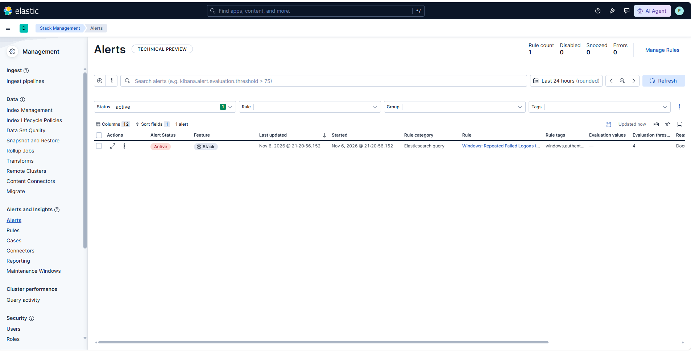
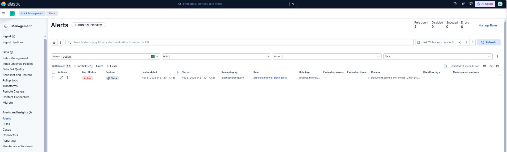

# Mốc 09 — Detection Rules trong Kibana

**Trạng thái:** Hoàn thành

**Ngày hoàn thành:** 06-11-2026

## 1. Mục tiêu đạt được

- Tạo hai Elasticsearch query rule nội bộ trong Kibana.
- Kiểm thử rule Windows bằng các event đăng nhập thất bại có kiểm soát.
- Kiểm thử rule pfSense bằng firewall block events thực tế.
- Xác nhận alert hiển thị trong Kibana mà không dùng email, webhook hoặc dịch
  vụ bên thứ ba.

## 2. Rule đã triển khai

| Rule | Data view / query | Điều kiện | Lịch chạy |
| --- | --- | --- | --- |
| `Windows: Repeated Failed Logons (4625)` | `Windows Security Events`; `event.code: "4625"` | Count > 4 trong 2 phút | Mỗi 1 phút |
| `pfSense: Firewall Block Burst` | `pfSense Firewall Events`; `event.action: block` | Count > 4 trong 2 phút | Mỗi 1 phút |

Cả hai rule bật `Exclude matches from previous runs` để giảm alert lặp. Rule
Windows gắn tags `windows`, `authentication`, `lab`; rule pfSense gắn tags
`pfsense`, `firewall`, `lab`. Không cấu hình connector/action bên ngoài phạm
vi lab.

## 3. Kiểm thử runtime

### Windows failed logon

Audit failure cho `Logon` đã được bật trên Windows Server. Năm lần xác thực sai
với tài khoản lab không tồn tại được tạo trong cửa sổ hai phút. Kibana Alerts
hiển thị rule Windows ở trạng thái **Active**, xác nhận ngưỡng đã được đáp ứng.

### pfSense firewall block burst

Sau khi điều chỉnh ngưỡng kiểm thử cho phù hợp tốc độ event thực tế của lab,
Kibana Alerts hiển thị rule pfSense ở trạng thái **Active**. Evaluation values
ghi nhận document count là 9 trong hai phút, vượt threshold 4.

## 4. Hạn chế và bước tiếp theo

- Ngưỡng pfSense hiện phù hợp để chứng minh pipeline/rule trong lab, không phải
  baseline dùng cho production. Cần tinh chỉnh theo lưu lượng bình thường nếu
  triển khai ngoài lab.
- Rule Windows hiện tổng hợp tất cả tài khoản để bảo đảm kiểm thử tái lập. Một
  cải tiến tiếp theo là group theo `user.name` sau khi thu thập đủ dữ liệu.
- Bước tiếp theo là đánh giá cuối, tổng hợp ảnh/bằng chứng và chuẩn bị báo cáo.
